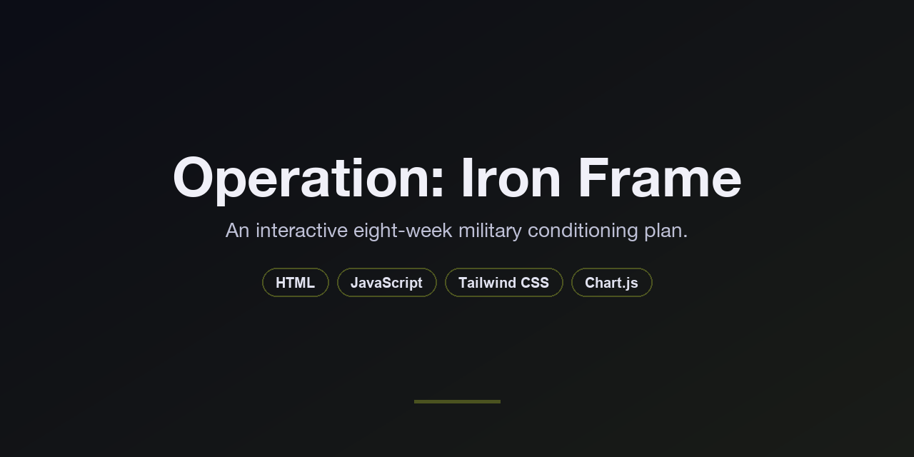
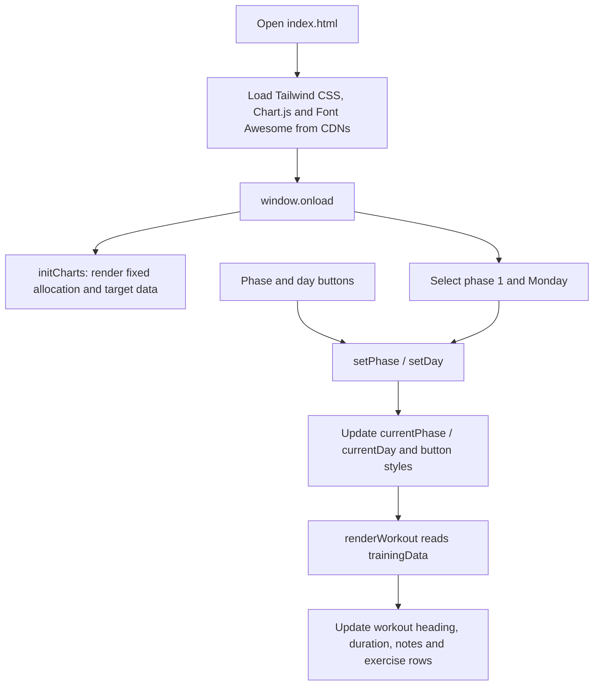

<p align="center">
  
</p>

<p align="center">
  
  
  
  
</p>

<p align="center">
  <b>Eight weeks of conditioning, one day's orders at a time.</b><br>
  Browse strength, cardio, recovery and test sessions in a single browser page.
</p>

---

## Overview

Operation: Iron Frame is a static fitness dashboard built around a preset training profile and an eight-week plan. Select a two-week phase and a day to see exercises, sets, repetitions, rest periods and technique notes. The same page includes training allocation charts, target progression, meal structure and posture drills.

## Features

- **Four training phases.** Base Conditioning, Hypertrophy Build, Peak Intensity, and Test & Taper each provide a Monday-to-Sunday schedule.
- **Daily orders.** Switching phase or day updates the workout title, focus, estimated duration, exercise table and tactical note.
- **Target charts.** A doughnut chart shows the preset training allocation; a line chart shows weekly push-up and sit-up targets.
- **Support logistics.** Reference cards outline meal timing, supplements and four posture drills.
- **Responsive layout.** The workout panel stacks on smaller screens and places day navigation beside the exercise table on wider screens.

> [!NOTE]
> The profile, workouts and chart values are hardcoded. Charts show planned targets, not recorded results. Selections reset on reload; there is no workout logging or persistent storage.

## How it works



Everything lives in [`index.html`](index.html): markup, styles, training data, chart configuration and interaction logic. The browser renders the plan locally, with external CDNs supplying styling, charts and icons.

## Tech stack

| Layer | Technology |
|---|---|
| Page | HTML5 and inline CSS |
| Layout and theme | Tailwind CSS CDN script with custom olive, slate and sand colors |
| Interaction | Plain JavaScript and DOM updates |
| Charts | Chart.js, loaded from jsDelivr |
| Icons | Font Awesome 6.0.0, loaded from cdnjs |
| Runtime | Web browser; no backend or package installation |

## Getting started

Clone the repository:

```bash
git clone https://github.com/rcemkarhan/military_fitness.git
cd military_fitness
```

Open `index.html` directly in a browser. To serve it locally instead, use Python 3:

```bash
python3 -m http.server 8000
```

Visit `http://localhost:8000`. Internet access is needed for the CDN dependencies. There is no install or build step; deployment consists of serving the repository as static files.

Select a phase under **Execution Protocol**, then choose a day under **Daily Operations**. Scroll to **Fuel Logistics** and **Posture Correction** for the reference cards.

## Project structure

```text
military_fitness/
├── index.html              Complete dashboard, training data and browser logic
├── README.md               Project overview and setup
└── .github/
    └── assets/banner.png   README banner
```

<details>
<summary><b>Customize the plan</b></summary>

- Edit `trainingData` in `index.html` to change phase schedules. Each day defines `title`, `focus`, `time`, `note` and an `exercises` array.
- Edit `initCharts()` to change allocation percentages or weekly targets. These values are separate from the workout schedules and do not recalculate when you select a phase.
- Update the Mission Briefing markup to change the preset profile, and the logistics markup to change the reference cards.
- Adjust `tailwind.config` and the inline style block to change the theme.

</details>
